# Hybrid InfraSec

**Secure infrastructure and Zero Trust evolution of a small company, from the first virtual machine to incident handling.**
Professional title project · Secure Infrastructure Administrator (AIS) · RNCP37680 · level 6 (EQF 6) · 2026

[English](#english) · [Français](#français)

**▶ Read the project online: https://0x1void.github.io/hybrid-infrasec/**

---

## English

### What this is

Hybrid InfraSec is the project I built for the French professional title *Administrateur d'infrastructures sécurisées*, a level 6 qualification (bachelor level) covering three certificates:

| Certificate | Skills | What the project proves |
|---|---|---|
| **CCP1** · Administer and secure the infrastructure | CP1 – CP4 | A virtualised foundation, filtered and hardened: network, systems, virtualisation, documented operations |
| **CCP2** · Design and deliver an evolution | CP5 – CP7 | Zero Trust remote access: need, four compared solutions, three-year cost, controlled rollout, monitoring |
| **CCP3** · Take part in cybersecurity management | CP8 – CP10 | Audit and EBIOS RM, a security policy applied and measured, detection and handling of real incidents |

The company, INFRASEC, is fictitious. The infrastructure is not: I built, operated and secured it myself, and every measurement, log and incident in the project is real.

### The lab in one picture

One hypervisor runs seven virtual machines. pfSense is the only exit. Behind it sit two directories (Windows Active Directory and a Samba continuity domain), TrueNAS file storage, a monitoring node (Prometheus, Grafana, Zabbix in rootless Podman) and a Wazuh SIEM. A WireGuard tunnel gives two separated profiles: the administrator reaches the LAN, the employee reaches the file share only.

### Highlights

- **Design:** four remote-access solutions scored on seven weighted criteria. WireGuard ranked first with 4.85 out of 5, and the three-year cost of ownership is 4,610 euros.
- **Delivery:** an ITIL-style change in eleven gated steps, acceptance tests from a WAN-side client, and a rollback that was actually tested.
- **Measure:** a three-layer audit (nmap, Lynis, Wazuh SCA) found 11 findings. An EBIOS RM analysis followed, and after the treatment plan no scenario is critical any more.
- **Apply:** a security policy of 12 verifiable articles. Hardening is measured (Lynis 69 → 76), password rules are enforced in both domains, backups are restored for real, and the lab backup is read-only.
- **Detect:** a local Wazuh rule alerts on SSH brute force in 2 seconds. Three more rules raise what was seen below the threshold, the SIEM is itself monitored, and logs are sealed every night with SHA-256.
- **After the oral exam (21–26 October 2026):** each jury remark became measured work: 18 incident and finding sheets, 5 test reports and 1 procedure.

### What you will find on the site

| Page | Content |
|---|---|
| Presentation | Plays by itself: every network architecture and every flowchart, explained one by one |
| Architecture | The lab layer by layer (OSI L1 → L7), then one sheet per machine with its flows and its internal flowchart |
| The project, CCP1, CCP2, CCP3 | The full report, written so that a junior can follow every step |
| Incident sheets | Finding, root cause, fix, proof, lesson, for each sheet |
| Commands | Every command used to build the lab from A to Z, then the test commands |
| Annexes, Glossary | Audit, EBIOS RM, security policy, operations manual; every abbreviation explained |

### How I worked

- What I claim, I prove. A fix counts only once the test that revealed the defect has been replayed, from a third machine.
- I read logs in the raw, from the command line, not only in a dashboard.
- Before every change I take a snapshot. I never store a secret in clear, I run rootless containers and I apply least privilege.

### Status and advice

The project is **complete and read-only**. The sources stay private; this repository only publishes the website.
**Your advice is welcome:** open a thread in [Discussions](https://github.com/0x1void/hybrid-infrasec/discussions). It helps me for the next project.

### Licence

© 2026 RJ. All rights reserved. You may read the site and share its link; reuse of the content requires my permission. See [LICENSE](LICENSE).

---

## Français

### De quoi s'agit-il

Hybrid InfraSec est le projet que j'ai réalisé pour le titre professionnel *Administrateur d'infrastructures sécurisées*. C'est un titre de niveau 6 (bac+3), composé de trois certificats :

| Certificat | Compétences | Ce que le projet démontre |
|---|---|---|
| **CCP1** · Administrer et sécuriser les infrastructures | CP1 – CP4 | Un socle virtualisé, filtré et durci : réseau, systèmes, virtualisation, exploitation documentée |
| **CCP2** · Concevoir et mettre en œuvre une évolution | CP5 – CP7 | Un accès distant Zero Trust : besoin, quatre solutions comparées, coût sur trois ans, mise en production maîtrisée, supervision |
| **CCP3** · Participer à la gestion de la cybersécurité | CP8 – CP10 | Audit et EBIOS RM, une politique de sécurité appliquée et mesurée, détection et traitement d'incidents réels |

L'entreprise INFRASEC est fictive. L'infrastructure ne l'est pas : je l'ai construite, exploitée et sécurisée moi-même, et chaque mesure, chaque journal et chaque incident du projet est réel.

### Le labo en une image

Un hyperviseur porte sept machines virtuelles. pfSense est la seule sortie. Derrière lui se trouvent :
- deux annuaires : Active Directory Windows et un domaine Samba de continuité ;
- le stockage de fichiers TrueNAS ;
- un nœud de supervision : Prometheus, Grafana et Zabbix, en Podman sans root ;
- un SIEM Wazuh.

Un tunnel WireGuard ouvre deux profils séparés. L'administrateur joint le LAN ; le salarié joint seulement le partage de fichiers.

### Points clés

- **Concevoir :** j'ai noté quatre solutions d'accès distant sur sept critères pondérés. WireGuard arrive en tête avec 4,85 sur 5, et son coût total sur trois ans est de 4 610 euros.
- **Mettre en production :** un changement de type ITIL en onze étapes jalonnées, une recette depuis un client côté WAN, et un retour arrière réellement éprouvé.
- **Mesurer :** un audit en trois couches (nmap, Lynis, Wazuh SCA) a relevé 11 constats. Une analyse EBIOS RM a suivi ; après le plan de traitement, plus aucun scénario n'est critique.
- **Appliquer :**
  - une PSSI de 12 articles vérifiables ;
  - un durcissement mesuré (Lynis 69 → 76) ;
  - une politique de mots de passe imposée dans les deux domaines ;
  - des restaurations réellement faites et une sauvegarde du labo en lecture seule.
- **Détecter :**
  - une règle Wazuh locale alerte sur une force brute SSH en 2 secondes ;
  - trois autres règles font remonter ce qui restait sous le seuil ;
  - le SIEM est lui-même supervisé ;
  - les journaux sont scellés chaque nuit en SHA-256.
- **Après l'oral (21–26 octobre 2026) :** chaque remarque du jury est devenue un travail mesuré, soit 18 fiches d'incident et de constat, 5 procès-verbaux et 1 procédure.

### Ce que vous trouverez sur le site

| Page | Contenu |
|---|---|
| Présentation | Se lit toute seule : chaque architecture réseau et chaque organigramme, expliqués un par un |
| Architecture | Le labo couche par couche (OSI L1 → L7), puis une fiche par machine avec ses flux et son organigramme interne |
| Le projet, CCP1, CCP2, CCP3 | Le dossier complet, écrit pour qu'un junior puisse suivre chaque étape |
| Fiches d'incident | Constat, cause racine, correction, preuve, enseignement, pour chaque fiche |
| Commandes | Toutes les commandes qui ont construit le labo de A à Z, puis les commandes de test |
| Annexes, Glossaire | Audit, EBIOS RM, PSSI, manuel d'exploitation ; chaque abréviation expliquée |

### Ma méthode

- Ce que j'affirme, je le prouve. Une correction ne compte que lorsque j'ai rejoué le test qui avait révélé le défaut, depuis une machine tierce.
- Je lis les journaux bruts, en ligne de commande, pas seulement dans un tableau de bord.
- Je prends un instantané avant chaque changement. Je ne garde aucun secret en clair, j'utilise des conteneurs sans root et j'applique le moindre privilège.

### Statut et conseils

Le projet est **terminé et en lecture seule**. Les sources restent privées ; ce dépôt publie uniquement le site.
**Vos conseils sont les bienvenus :** ouvrez un fil dans [Discussions](https://github.com/0x1void/hybrid-infrasec/discussions). Ils m'aident pour le projet suivant.

### Licence

© 2026 RJ. Tous droits réservés. Vous pouvez lire le site et partager son lien ; toute réutilisation du contenu demande mon accord. Voir [LICENSE](LICENSE).
